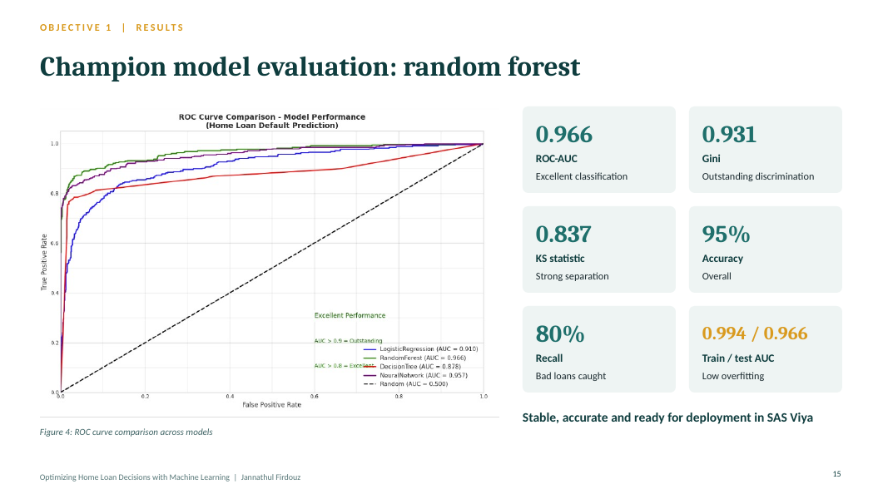
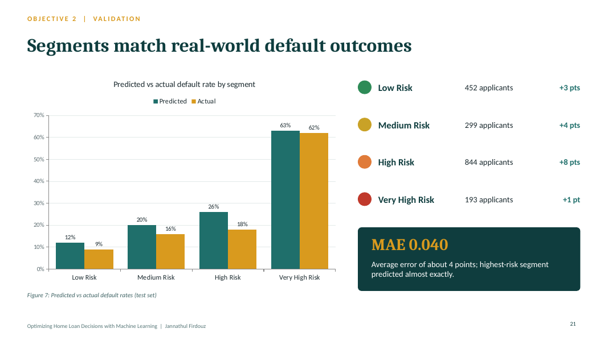
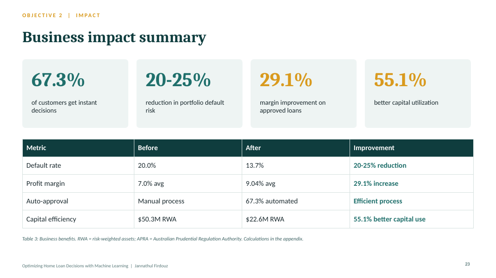
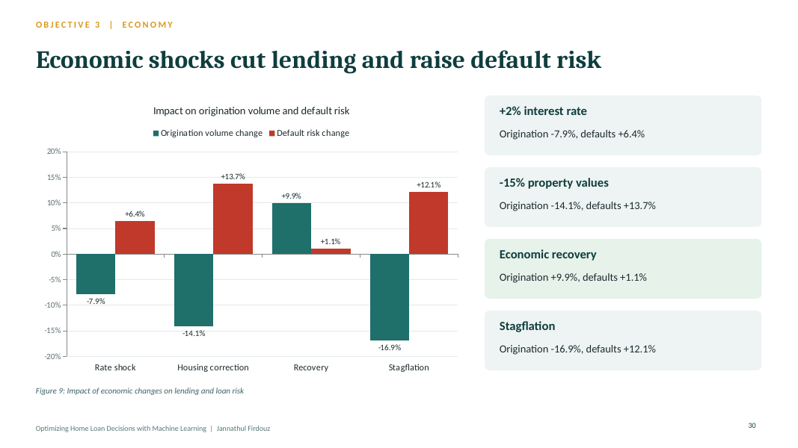

# Optimizing Home Loan Origination Decisions Using Machine Learning

**Mortgage credit risk modelling, borrower segmentation and regulatory stress testing** | Master of Analytics Capstone, Auckland University of Technology, in partnership with SAS


📊 **Presentation:** [View PDF](presentation/Home_Loan_Origination_Scorecard_Analysis.pdf) | [Download PowerPoint](presentation/Home_Loan_Origination_Scorecard_Analysis.pptx)

## Overview

Australian lenders face rising interest rates, tighter lending regulation and growing affordability pressure, while borrowers expect faster decisions. This project uses machine learning in SAS Viya to predict borrower default risk and turn those predictions into practical, data-driven lending decisions.

## Objectives

1. **Develop and evaluate loan origination models** that predict default risk
2. **Segment borrowers by risk profile** to support targeted approval, pricing and monitoring
3. **Analyse regulatory and economic impacts** on loan eligibility, origination volume and housing market health

## Key results

| Area | Result |
|---|---|
| Champion model | Random forest: 95.0% accuracy, ROC-AUC 0.966, F1 0.866, Gini 0.931, KS 0.837 |
| Overfitting check | Train AUC 0.994 vs test AUC 0.966 |
| Segmentation | 4 risk tiers via K-means (K = 4), mean absolute error 0.040 vs actual defaults |
| Instant decisions | 67.3% of applications auto-approved |
| Default risk | 20-25% reduction in portfolio default rate |
| Profitability | 29.1% margin improvement per approved loan through risk-based pricing |
| Capital | 55.1% lower risk-weighted assets |
| Market health | Score of 69.2 / 100 today, rising to 97.2 with the recommended policy package |

---

## Dataset: HMEQ Home Equity Loans

- **Source:** [HMEQ (Home Equity Loan) Dataset](https://www.kaggle.com/datasets/ajay1735/hmeq-data)
- **Total observations:** 5,960 loan applications
- **Total variables:** 13
- **Objective:** Predict loan default risk (credit risk modelling)

### Target variable

| Variable | Description | Values |
|----------|-------------|--------|
| `BAD` | Loan default indicator | 1 = Borrower defaulted<br>0 = Borrower repaid loan |

**Default rate:** 20%, a realistic class imbalance commonly observed in credit risk data.

### Predictor variables

| Group | Variable | Description |
|---|---|---|
| Financial | `LOAN` | Loan amount requested |
| | `MORTDUE` | Amount still owed on existing mortgage |
| | `VALUE` | Current value of property |
| | `DEBTINC` | Debt-to-income ratio |
| Employment | `JOB` | Occupation category |
| | `YOJ` | Years at current job |
| Credit behaviour | `DEROG` | Number of derogatory credit reports |
| | `DELINQ` | Number of delinquent credit lines |
| | `CLAGE` | Age of oldest credit line (months) |
| | `NINQ` | Number of recent credit inquiries |
| | `CLNO` | Number of credit lines |
| Loan purpose | `REASON` | Debt consolidation or home improvement |

---

## Methodology

### 1. Data preparation
- Regression-based, group-wise imputation of missing values, plus missing-value indicators. DEBTINC was missing for 65% of defaulters vs 10% of non-defaulters, so missingness itself is a strong risk signal.
- Winsorization of financial outliers at the 1st / 99th percentiles; risk-related outliers (e.g. delinquencies) kept as genuine behaviour.

### 2. Feature engineering: Weight of Evidence (WOE) and Information Value (IV)

**Why WOE:** handles categorical variables, improves interpretability, stabilises logistic regression and follows credit risk modelling standards.

```
WOE = ln( % of non-defaults / % of defaults )
IV  = Σ ( % of non-defaults - % of defaults ) × WOE
```

| Feature | IV | Strength |
|---|---|---|
| DEBTINC | 0.7751 | Very strong |
| DELINQ | 0.5411 | Very strong |
| CLAGE | 0.2434 | Medium |
| DEROG | 0.2317 | Medium |
| NINQ | 0.1575 | Medium |
| LOAN | 0.0972 | Weak |
| MORTDUE | 0.0469 | Weak |
| VALUE | 0.0443 | Weak |
| YOJ | 0.0281 | Weak |
| CLNO | 0.0211 | Weak |

A derived loan-to-value (LTV) ratio was also created.

### 3. Modelling
- 70 / 30 stratified train-test split (4,172 / 1,788) with class weighting
- Models compared: Logistic Regression, Decision Tree, Random Forest, Neural Network, Gradient Boosting

| Model | Accuracy | F1-score | ROC-AUC |
|---|---|---|---|
| Logistic Regression | 85.1% | 69.3% | 91.0% |
| Decision Tree | 91.1% | 78.0% | 87.8% |
| Neural Network | 94.9% | 86.1% | 95.7% |
| **Random Forest** | **95.0%** | **86.6%** | **96.6%** |



### 4. Borrower segmentation and lending strategy
- K-means clustering, with K = 4 supported by the elbow method, silhouette (0.19), Davies-Bouldin (1.617) and Calinski-Harabasz (868.6)
- Four personas: Secure, Managing, Strained and Vulnerable borrowers
- Each segment mapped to an approval action, pricing band and monitoring level





### 5. Regulatory and economic analysis
- Three APRA-based regulatory scenarios: current settings, tightened regulation, first home buyer support
- Four macroeconomic stress scenarios: interest rate shock, housing correction, economic recovery, stagflation
- Five-dimension housing market health scorecard and cumulative policy impact



---

## Tools
- SAS Viya
- SAS Workbench / SAS Machine Learning
- Python
- Data analytics and visualisation

## Limitations and future work
- The dataset has no date fields, so results cannot be linked to economic time series
- Historical / synthetic data may not reflect current market conditions
- Next steps: add economic indicators, apply explainable AI (SHAP, LIME), validate on real bank data, and extend segmentation with behavioural and regional features

## Repository structure

```
├── presentation/
│   ├── Home_Loan_Origination_Scorecard_Analysis.pptx   # full deck with speaker notes
│   └── Home_Loan_Origination_Scorecard_Analysis.pdf    # PDF for viewing on GitHub
├── results/
│   └── figures/                                        # charts and slide previews
├── LICENSE
└── README.md
```

## Acknowledgements
Supervisor Dr. Shu Su, and Lucy Biasi, Janhav Khanna, Lachlan Catto and Jennifer Chuor (SAS).

## Author
**Jannathul Firdouz Sahul Hameed**
Master of Analytics, Auckland University of Technology
